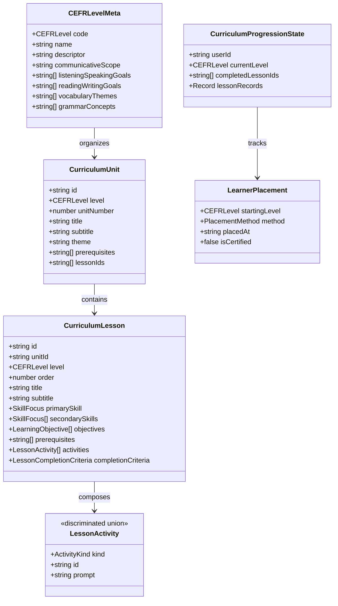

# Lexi — CEFR Curriculum Architecture & Learning Foundation

**Document Version**: 1.0.0 (Phase 4 Baseline)  
**Status**: APPROVED & IMPLEMENTED  
**Scope**: Foundational English-learning curriculum, structured content model, learner placement, progression engine, and offline-first persistence.

---

## 1. Pedagogical Framework & Disclaimer

Lexi aligns its instructional sequencing with the **Common European Framework of Reference for Languages (CEFR)** across six global proficiency tiers:
- **A1 — Beginner** (Foundational Everyday Interactions)
- **A2 — Elementary** (Routine Tasks, Travel, and Immediate Needs)
- **B1 — Intermediate** (Independent Expression & Unprepared Conversation) — *Planned*
- **B2 — Upper Intermediate** (Spontaneous Fluency & Technical Discourse) — *Planned*
- **C1 — Advanced** (Implicit Nuance, Idiom, and Professional Register) — *Planned*
- **C2 — Proficient** (Rhetorical Mastery & Conceptual Precision) — *Planned*

> [!IMPORTANT]
> **Accreditation Disclaimer**: Lexi utilizes the CEFR strictly as a pedagogical framework for content organization, communicative task design, and progression sequencing. Lexi is not an accredited language testing institution and does not issue certified CEFR certificates. Learner placements are self-selected or preliminary diagnostic indicators.

---

## 2. Curriculum Data Model & Type System

The curriculum is modeled declaratively in [`src/types/curriculum.ts`](file:///home/abhiboss/Projects/Lexi/src/types/curriculum.ts) and strictly decoupled from React presentation components.

### Core Entities

### Multi-Modal Activity Kinds (Discriminated Union)

1. **`multiple-choice`**: Contextual comprehension with distractor rationales and audio prompts.
2. **`dialogue`**: Multi-turn roleplay conversations with context, transcripts, and comprehension checks.
3. **`fill-blank`**: Target vocabulary and grammatical particle completion in communicative sentences.
4. **`sentence-order`**: Reconstructing authentic syntactic sequences from scrambled phrase tiles.
5. **`listening`**: Auditory comprehension testing speed, intonation, and detail extraction.
6. **`pronunciation-prompt`**: Target phrase shadowing with IPA phoneme guidance and audio playback.
7. **`matching`**: Pairing conversational prompts with natural rejoinders.
8. **`writing-prompt`**: Guided short synthesis with required keywords and communicative criteria.

---

## 3. Initial Curated Curriculum (A1 & A2)

A total of **6 Units and 14 Curated Lessons** are implemented and active for A1 and A2, providing a coherent beginner learning path directly integrated with the Lexi UI.

### Level A1: Beginner (Foundational Communication)

#### Unit 1: Greetings & Introductions (`a1-unit-1`)
*Theme: Social & Basics • Prerequisites: None*
- **Lesson 1: Saying Hello & Goodbye** (`a1-u1-l1-hello`)
  - *Objectives*: Formal vs. informal greetings, time-of-day salutations (`Good morning` vs. `Good evening`), natural goodbye phrasing.
  - *Activities*: Time-based greeting choice, office hallway dialogue, positive modifier fill-in, pronunciation shadowing.
- **Lesson 2: Introducing Yourself & Others** (`a1-u1-l2-introductions`)
  - *Objectives*: "I am...", "My name is...", introducing colleagues, verb "to be" in present simple.
  - *Prerequisites*: `a1-u1-l1-hello`
- **Lesson 3: Essential Courtesies** (`a1-u1-l3-courtesies`)
  - *Objectives*: "Excuse me", "You're welcome", apologising for delays, requesting attention politely.
  - *Prerequisites*: `a1-u1-l2-introductions`
- **Lesson 4: Everyday Check-ins** (`a1-u1-l4-checkins`)
  - *Objectives*: "How are you doing?", reciprocating inquiries ("How about you?"), natural status replies.
  - *Prerequisites*: `a1-u1-l3-courtesies`

#### Unit 2: Daily Life & Routines (`a1-unit-2`)
*Theme: Daily Life • Prerequisites: `a1-unit-1`*
- **Lesson 1: Numbers, Dates & Time** (`a1-u2-l1-time`)
  - *Objectives*: Numbers 1-100, "Quarter to three", days of the week, scheduling lessons.
  - *Prerequisites*: `a1-u1-l4-checkins`
- **Lesson 2: Everyday Conversations** (`a1-u2-l2-everyday-conversations`)
  - *Objectives*: Sustaining 3-turn exchanges, library and store inquiries, "Could I please...".
  - *Prerequisites*: `a1-u2-l1-time`
  - *UI Anchor*: Powers the Home page **Continue Learning** card.
- **Lesson 3: At the Bus Stop** (`a1-u2-l3-bus-stop`)
  - *Objectives*: Asking for routes ("Does this bus go to...?"), frequency inquiries, transit etiquette.
  - *Prerequisites*: `a1-u2-l2-everyday-conversations`
  - *UI Anchor*: Referenced in Home page **Next Lesson** footer.
- **Lesson 4: Weekend Plans** (`a1-u2-l4-weekend-plans`)
  - *Objectives*: Near future with "going to", leisure activities, park visits.
  - *Prerequisites*: `a1-u2-l3-bus-stop`

#### Unit 3: Food, Cafés & Shopping (`a1-unit-3`)
*Theme: Everyday Commerce • Prerequisites: `a1-unit-2`*
- **Lesson 1: Ordering at a Café** (`a1-u3-l1-cafe-order`)
  - *Objectives*: "Could I have...", milk customizations (oat/almond), "For here or to go?".
  - *UI Anchor*: Integrates with the Home **Café Conversation** featured activity.
- **Lesson 2: Morning Bakery** (`a1-u3-l2-bakery`)
  - *Objectives*: Quantifiers ("a loaf of", "two slices of"), fresh bakery items.
  - *UI Anchor*: Integrates with the Explore **Morning Bakery** adventure.
- **Lesson 3: Shopping Day** (`a1-u3-l3-shopping-day`)
  - *Objectives*: Garment sizes (S/M/L), fitting rooms, inquiring about prices.
  - *UI Anchor*: Integrates with the Explore **Shopping Day** adventure.
- **Lesson 4: Handling Cash & Card Payments** (`a1-u3-l4-payment`)
  - *Objectives*: Contactless payments, receipts, courteous closings.
  - *Prerequisites*: `a1-u3-l3-shopping-day`

---

### Level A2: Elementary (Expanding Everyday Situations)

#### Unit 4: Travel & Directions (`a2-unit-4`)
*Theme: Travel & Mobility • Prerequisites: `a1-unit-3`*
- **Lesson 1: Asking for & Giving Directions** (`a2-u4-l1-directions`): Turn left/right, go past, opposite landmarks.
- **Lesson 2: At the Airport & Transit** (`a2-u4-l2-airport-transit`): Luggage drop, gates, boarding calls (*Anchor: At the Airport scenario*).
- **Lesson 3: Checking into a Hotel** (`a2-u4-l3-hotel-checkin`): Confirming reservations, breakfast hours, keycards.

#### Unit 5: Work, Study & Socializing (`a2-unit-5`)
*Theme: Work & Community • Prerequisites: `a2-unit-4`*
- **Lesson 1: Talking About Work & Studies** (`a2-u5-l1-job-talk`): Roles, responsibilities, "I work in marketing" (*Anchor: Job Interview scenario*).
- **Lesson 2: Making Plans with Friends** (`a2-u5-l2-making-plans`): Invitations, declining politely, proposing alternative dates.
- **Lesson 3: At the Clinic & Pharmacy** (`a2-u5-l3-health-visit`): Ailments, symptoms, dosage directions.

#### Unit 6: Present vs Past Experiences (`a2-unit-6`)
*Theme: Grammar & Storytelling • Prerequisites: `a2-unit-5`*
- **Lesson 1: What Did You Do Yesterday?** (`a2-u6-l1-yesterday`): High-frequency irregular verbs (`went`, `saw`, `bought`, `had`).
- **Lesson 2: Present vs. Past in Real Situations** (`a2-u6-l2-present-vs-past`): Habitual vs. completed events (*Anchor: Explore "Present vs Past" unit*).
- **Lesson 3: Sharing a Memorable Trip** (`a2-u6-l3-memorable-trip`): Narrative connectors (`first`, `then`, `after that`, `finally`).

---

## 4. Progression & Deterministic Prerequisite Engine

The progression engine implemented in [`src/services/progressionEngine.ts`](file:///home/abhiboss/Projects/Lexi/src/services/progressionEngine.ts) enforces strict mathematical and pedagogical rules:

1. **Lesson Unlocking (`isLessonUnlocked`)**:
   - A lesson is unlocked if and only if **all prerequisite lessons** have been completed with passing score ($\ge 80\%$).
   - A lesson belonging to a subsequent unit requires that the parent unit's prerequisite units are complete.
2. **Next Lesson Recommendation (`getNextRecommendedLesson`)**:
   - Linearly scans the active units within the learner's current CEFR level.
   - Recommends the earliest incomplete, unlocked lesson according to the pedagogical order.
   - Automatically transitions to the next unit upon completion of all preceding lessons.
3. **Graph Integrity & DAG Cycle Detection (`validateCurriculumIntegrity`)**:
   - Performs Depth-First Search with recursion-stack tracking across all lessons and prerequisites.
   - Proves zero circular dependency loops exist in the curriculum graph.
   - Verifies zero orphaned lessons or duplicate IDs.

---

## 5. Offline-First Local Persistence Architecture

Implemented in [`src/db/curriculumRepository.ts`](file:///home/abhiboss/Projects/Lexi/src/db/curriculumRepository.ts):

- **Repository Abstraction (`ICurriculumRepository`)**:
  - `getLearnerProgress(userId: string): Promise<CurriculumProgressionState>`
  - `recordLessonCompletion(userId: string, lessonId: string, scorePercent: number): Promise<CurriculumProgressionState>`
  - `setLearnerLevel(userId: string, level: CEFRLevel): Promise<void>`
- **Storage Strategy**:
  - **Browser Environment**: Dexie.js (IndexedDB) Schema v2 (`curriculumProgress: 'userId, currentLevel, updatedAt'`), preserving user streaks and profile state.
  - **Headless / Node Environment**: `InMemoryCurriculumRepository` for unit test isolation without external mock packages.
- **Privacy & Resilience**: 100% client-side; zero cloud database dependencies, zero API costs, zero data leakage.

---

## 6. Planned Roadmap (Levels B1–C2)

Units and lessons for B1, B2, C1, and C2 are formally modeled in [`src/data/curriculum/futureLevels.ts`](file:///home/abhiboss/Projects/Lexi/src/data/curriculum/futureLevels.ts) with `"status": "planned"`:
- **B1**: Professional networking, STAR interview methodology, hypothetical second conditionals.
- **B2**: Nuanced argumentation, media analysis, complex passive and cleft structures.
- **C1**: Executive diplomacy, softening critique, academic and strategic discourse.
- **C2**: Rhetorical subtext, literary idiom, dialectal precision.
