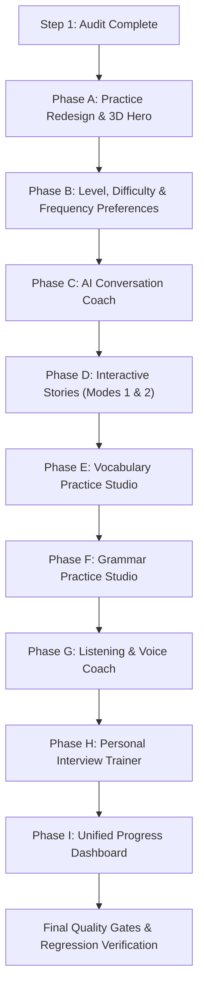

# Lexi — Practice & AI Coach Feature Audit
**Audit Date:** 2026-10-19  
**Target:** Lexi English Learning Application (React 19 + TypeScript 5.7 + Vite 6 + Dexie.js 4 + Tailwind CSS v4 + Playwright)

---

## 1. Executive Summary

This audit evaluates the current implementation status of Lexi against the product expansion requirements for the **AI English Coach Transformation** (Personalised Practice, AI Conversation, Interview Training, and Unified Dashboard).

The Home screen, Explore screen, CEFR Curriculum Foundation, Interactive Lesson Player (8 activity types), and Spaced-Repetition Vocabulary Notebook (FSRS v4.4.0) are fully implemented, verified, and passing 58 Playwright tests and 38 Vitest unit tests.

However, the practice shortcuts on the Home screen and the interim Practice/Progress screens currently rely on generic modals or placeholders. The table below delineates what currently works, what is partial, and what is absent.

---

## 2. Feature-by-Feature Implementation Audit

| Feature Area | Current State in Repository | Implementation Status | Deficiencies / Gaps to Address |
| :--- | :--- | :--- | :--- |
| **Practice Screen Title & Layout** | Titled `Vocabulary Notebook`, focused exclusively on FSRS flashcard reviews. | **Partial** | Must be renamed and broadened into `Practice`. Needs an editorial 3D character illustration hero card matching Home hero quality, category navigation, and preserved deck controls. |
| **Category Navigation** | `LEARNING_SHORTCUTS` exists on Home screen (`Conversation`, `Stories`, `Vocabulary`, `Grammar`, `Listening`). | **Partial** | Clicking shortcuts opens `ActivityModal` with descriptive static text ("Module: Conversation Essentials") instead of launching actual dedicated practice experiences. |
| **Learner Level & Difficulty** | User profile stores `cefrLevel: 'A2'`, `dailyGoalMinutes: 15`. No difficulty rating exists. | **Partial** | Missing `Easy`, `Medium`, and `Hard` difficulty settings, session length options (`Quick`, `Standard`, `Extended`), frequency preferences, and adaptive recommendations. |
| **AI Conversation Coach** | No conversation engine exists. | **Absent** | Needs interactive chat interface, topic selection (daily life, workplace, travel, interview prep), level adaptation, tactful correction modes, and end-of-session evaluation report. |
| **Interactive Stories** | No story module exists. | **Absent** | Needs Mode 1 ("Tell me a story" with comprehension checks) and Mode 2 ("Let me tell a story" with transcript grammar/clarity analysis). |
| **Vocabulary Practice Studio** | `VocabularyNotebookScreen`, `VocabularyCardItem`, and `ReviewPlayer` (FSRS v4.4.0) are fully working. | **Partial** | Flashcard review works, but multimodal exercises (fill-in-the-blank, word-meaning matching, sentence construction, quizzes) are not yet integrated into the studio. |
| **Grammar Practice Studio** | Lessons have grammar activities in curriculum, but no standalone grammar studio exists. | **Absent** | Needs targeted grammar topic selection, explanations, sentence transformation, error correction, and recurring mistake tracking. |
| **Listening & Voice Coach** | Web Speech API synthesis works for TTS. No voice recognition or dictation exists. | **Partial** | Needs listening comprehension dialogues, dictation exercises, playback speed controls, and Web Speech STT (`SpeechRecognition`) integration with graceful fallbacks. |
| **Personal Interview Trainer** | No interview practice exists. | **Absent** | Needs job description input/parser, role-specific & STAR behavioural question generator, mock interview player, and constructive feedback report. |
| **Unified Progress Dashboard** | `activeTab === 'Progress'` renders a static interim placeholder card. | **Absent** | Needs real metrics calculated from Dexie: practice minutes, skill breakdown, grammar accuracy by topic, recurring mistakes, and actionable next-step recommendations. |
| **Database Schema** | Dexie Schema v3 (`users`, `curriculumProgress`, `vocabularyCards`, `reviewLogs`). | **Working (v3)** | Requires Schema v4 migration to add `learnerPreferences`, `practiceSessions`, and `assessmentReports` while preserving existing learner progress. |
| **AI Integration Layer** | No external AI SDK or proxy is configured. | **Absent** | Requires dual-mode architecture: live Gemini API integration when `VITE_GEMINI_API_KEY` is present, with intelligent local deterministic engine fallback when offline or unconfigured. |

---

## 3. Detailed Component & Service Inventory

### 3.1 Navigation & App Shell (`src/App.tsx`)
- **Working**: 4 bottom navigation tabs (`Home`, `Explore`, `Practice`, `Progress`). Active indicators, header streaks, and modal launch.
- **Limitation**:
  - `Practice` tab only hosts `VocabularyNotebookScreen`.
  - `Progress` tab is an interim placeholder.
  - Quick shortcuts on Home open generic description dialogs.

### 3.2 Curriculum & Lesson Engine (`src/components/lesson/`, `src/services/lessonScoring.ts`)
- **Working**: 8 interactive activity renderers:
  1. Multiple Choice
  2. Dialogue Comprehension (with TTS audio)
  3. Fill-in-the-Blank
  4. Sentence Order (interactive chips)
  5. Listening Comprehension
  6. Pronunciation Prompt
  7. Matching Pairs
  8. Short Writing / Explanation
- Pure deterministic scoring service with $80\%$ passing grade, stars, and celebratory summary.
- **Opportunity**: These proven activity patterns can be directly repurposed for the Vocabulary, Grammar, and Listening studios.

### 3.3 Vocabulary & FSRS (`src/components/vocabulary/`, `src/services/fsrsScheduler.ts`)
- **Working**: `ts-fsrs` v4.4.0 with $90\%$ retention, deterministic previews, 4-tier ratings (`Again`, `Hard`, `Good`, `Easy`), due-review banner, and Dexie v3 persistence.
- **Rule to preserve**: `Again`, `Hard`, `Good`, `Easy` are memory recall quality ratings for FSRS, completely independent of the learner's overall difficulty preference (`Easy`, `Medium`, `Hard`).

### 3.4 Speech & Audio Infrastructure
- **Text-to-Speech (TTS)**: Built-in Web Speech API `window.speechSynthesis` works across all modern browsers.
- **Speech-to-Text (STT)**: `window.SpeechRecognition` / `window.webkitSpeechRecognition` can be used for voice input without external paid APIs. When microphone access is denied or unsupported, standard keyboard text input acts as an automatic fallback.

### 3.5 External AI Architecture Strategy
- In strict adherence to Section 12:
  1. Never expose private API keys in client-side repositories.
  2. Provide a flexible AI coach adapter interface:
     - **Live Mode**: Calls Gemini API via configurable `VITE_GEMINI_API_KEY` or backend endpoint.
     - **Deterministic Offline Coach**: Powered by curated CEFR conversational templates, syntactic grammar rules, and rubric-based evaluation. This guarantees that all 8 modules are immediately usable and testable offline, in CI, and with zero API cost.
  3. Include a `.env.example` file documenting configuration options.

---

## 4. Sequential Implementation Roadmap

Following the mandated delivery sequence:

1. **Phase A — Practice Screen Redesign**:
   - Rename `Vocabulary Notebook` to `Practice`.
   - Add editorial 3D character hero illustration card matching Home hero visual quality.
   - Add 5 category practice navigation cards: Conversation, Stories, Vocabulary, Grammar, Listening.
   - Retain FSRS deck, statistics strip, filters, and review flow.
2. **Phase B — Learning Level, Difficulty & Frequency**:
   - Add Difficulty (`Easy`, `Medium`, `Hard`) and Practice Frequency/Session Length settings.
   - Safe Dexie v4 migration preserving all data.
   - Adaptive activity recommendations.
3. **Phase C — AI Conversation Coach**:
   - Topic selection, chat interface, level adaptation, gentle corrections, and structured evaluation report.
4. **Phase D — Interactive Stories**:
   - Mode 1 (reading/listening comprehension) and Mode 2 (learner story writing/speaking with analysis).
5. **Phase E — Vocabulary Practice Studio**:
   - Expand FSRS deck with quizzes, matching, fill-in-the-blank, and sentence construction drills.
6. **Phase F — Grammar Practice Studio**:
   - Topic explanations, sentence transformation, error correction, and recurring mistake tracking.
7. **Phase G — Listening & Voice Coach**:
   - Comprehension dialogues, dictation, speed controls, and Web Speech voice input.
8. **Phase H — Personal Interview Trainer**:
   - Job description parser, role-specific & STAR behavioural questions, mock interview, and preparation plan.
9. **Phase I — Unified Progress Dashboard**:
   - Real calculated metrics, practice time, skill radar/breakdown, error trends, and explainable next-step recommendations.
10. **Phase J — Final Integration & Verification**:
    - Comprehensive Playwright and Vitest regression suites, responsive screenshots (320px–1280px), accessibility audit.

---

## 5. Implementation Completion Status

All planned phases and enhancements have been implemented and verified against the production build:
- **Phase A — Practice Screen Redesign**: Dedicated 3D hero card, clean category chips without redundant hub, FSRS deck integration.
- **Phase B / Phase 4 — Personalized Learning Preferences**: App-wide CEFR level selector (A1-C1) with explicit change confirmation, 3 difficulty tiers (Easy/Medium/Hard), session length (Quick/Standard/Extended), daily goals (5-30m), feedback styles, contextual hints, practice day schedules, and reminder frequency.
- **Phase C — Conversation Coach**: Alex, Sophia, and Maya personas; Web Speech synthesis and recognition with text fallback; structured scorecards.
- **Phase D — Story Studio**: Modes 1 & 2; CEFR graded readers, audio narration, and collaborative writing co-creator.
- **Phase E — Vocabulary Practice Studio**: Multimodal 5-station circuit (Quiz, Match pairs, Fill-in-the-blank, AI Sentence Writer, Pronunciation), session scorecard, FSRS sync.
- **Phase F — Grammar Practice Studio**: Diagnostic drills, error correction, token chip reordering, and pattern tracking.
- **Phase G — Listening & Voice Coach**: Real-life audio scenarios, variable playback speed (0.8x, 1.0x, 1.2x), dictation check, and voice retell.
- **Phase H — Interview Trainer**: Predefined tracks + custom JD parser, STAR framework scaffolding, speech recognition, and comprehensive preparation report.
- **Phase I — Unified Progress Dashboard**: Calculated practice metrics, skill mastery breakdown, FSRS memory retention curves, and diagnostic error trends.
- **Quick Picks Activity Hub ("See All")**: Full-screen responsive hub featuring 10 interactive learning activities with completion tracking, category filtering, search, and Dexie v6 persistence.
- **Quality Gates**: 71/71 Vitest unit tests passed; 120/120 Playwright E2E tests passed; clean Vite production build in 1.63s.

